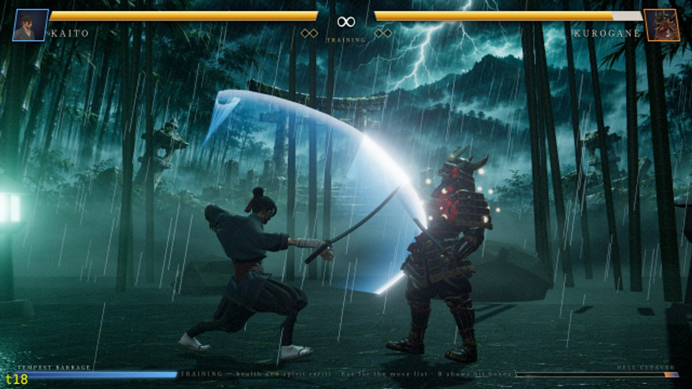
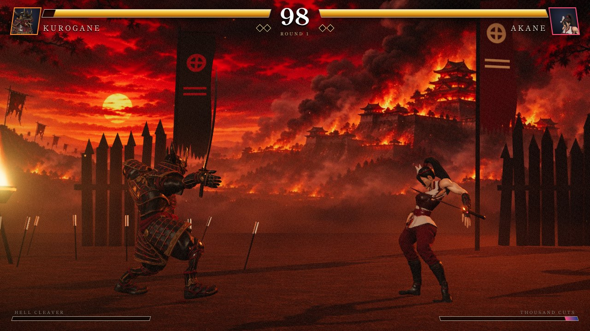
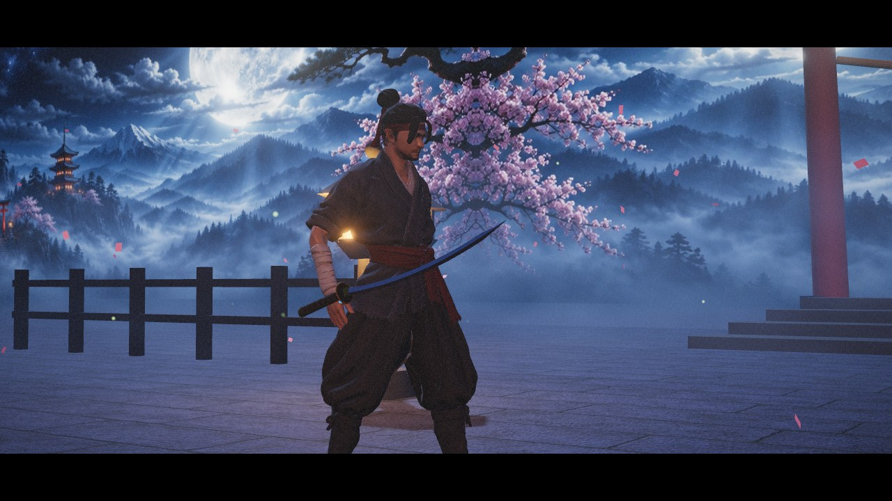

# Swift Sword 疾剣

A cinematic **3D samurai fighting game** that runs in the browser — no install,
no build step. Three.js renders AI-generated fighters and painted arenas with
real-time lighting, shadows, bloom, weather and blood; a deterministic 60 Hz
simulation drives the fight.



| | |
|---|---|
|  |  |

**Play:** open the GitHub Pages site for this repository (deployed from `main`).
The original pixel-art edition is preserved at [`classic/`](classic/).

## What's in it

- **Fighters** — KAITO (balanced ronin), AKANE (fast fox-masked assassin),
  KUROGANE (armoured heavy) and the unlockable boss SHURA. Each has its own
  reach, speed, power, projectile and Spirit Art (super).
- **Arenas** — Moonlit Shrine (petals, fireflies), Burning Keep (embers,
  braziers, war banners) and Storm Grove (rain, swaying bamboo, lightning).
- **Combat** — 3-hit slash chains, heavy cleave, low thrust, sweep, air slash,
  guard-breaking throw, dashes with invulnerable back-step, three special arts
  per fighter, supers, counters, combo scaling, chip damage, sudden death.
- **Presentation** — cinematic intro shots and name cards, slow-motion KO
  camera, blade trails, hit sparks, blood and floor stains (toggleable),
  screen shake, announcer, victory kata.
- **Modes** — Arcade ladder (with a mirror match and a boss), Versus CPU,
  Two Players, Training (hit boxes with `B`), Watch (CPU vs CPU).
- **Everywhere** — keyboard, two gamepads, and on-screen touch controls;
  installable PWA with offline play.

## Controls

| | Player 1 | Player 2 |
|---|---|---|
| Move / guard (hold away) | `A` `D` | `←` `→` |
| Jump / crouch | `W` / `S` | `↑` / `↓` |
| Slash (tap again on hit to chain) | `F` | `K` |
| Cleave | `G` | `L` |
| Wave / dash slash / rising slash | `R` `T` `Y` | `I` `O` `P` |
| Spirit Art (full gauge) | `H` or `F`+`G` | `;` or `K`+`L` |

Motion inputs also work: `↓ →` + Slash (wave), `↓ →` + Cleave (dash slash),
`↓ ↓` + Slash (rising slash), `→` + Slash up close (throw), double-tap a
direction to dash. `Esc` pauses, `M` mutes music, `F11` toggles fullscreen.

## Running locally

```sh
npm start          # serves the folder at http://localhost:8080
npm test           # static checks + headless simulation tests + classic tests
```

Any static file server works; the game is plain ES modules loaded through an
import map (`index.html` → `src/main.js`, three.js vendored under `vendor/`).

Handy deep links: `?auto=cpu&p1=akane&p2=kurogane&stage=storm` jumps straight
into a match; `?q=low|medium|high` forces a graphics preset; `?debug` shows
hit boxes. For recording footage, `?capture=30` hands the frame loop to an external recorder (`__game.captureFrame()` advances exactly 1/30 s per call), `?seed=N` makes CPU fights reproducible and `?diff=0..2` sets the difficulty for the run.

## How it is built

```
src/config.js     fighters, frame data, stages (pure data)
src/sim.js        deterministic fight simulation + CPU opponent (no DOM)
src/fighter3d.js  skinned models, animation blending, katana, blade trails
src/stage3d.js    arenas: backdrop, lit floor, props, mist, weather
src/fx.js         particles, blood, projectiles, flames
src/gfx.js        renderer, post-processing, camera director
src/ui.js         DOM menus, HUD, announcer, touch controls
src/audio.js      sample playback and music (recorded audio only)
src/main.js       game flow and the frame loop
tests/            simulation tests (Node) and an optional browser flow test
tools/            offline asset pipeline (auto-rig, animation bake, GLB build)
```

Every attack's frame data is tied to its animation: the startup frames play
the clip up to the instant the blade crosses the target, so the hit box turns
on exactly when the sword visibly lands. The simulation emits events (hits,
call-outs, camera cues) that the presentation layer turns into effects, sound
and UI — which is also why the whole fight can be tested headlessly.

### Asset pipeline

Characters, backdrops, ground textures and two music tracks were generated
with [Higgsfield](https://higgsfield.ai) (concept image → Tripo image-to-3D
mesh → rig). Animations come from the CC0 Quaternius Universal Animation
Library and are retargeted and baked into each character file by the scripts
in [`tools/`](tools/). See [CREDITS.md](CREDITS.md) for every source and licence.

## Licence

Game code: MIT. Third-party assets and libraries keep their own licences —
see [CREDITS.md](CREDITS.md).
